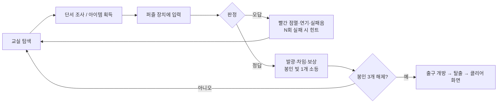
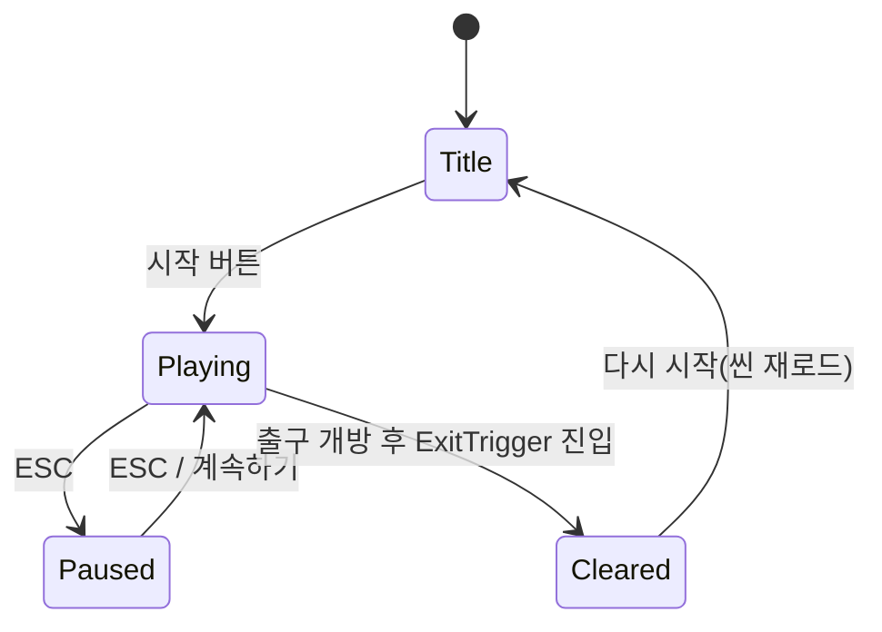
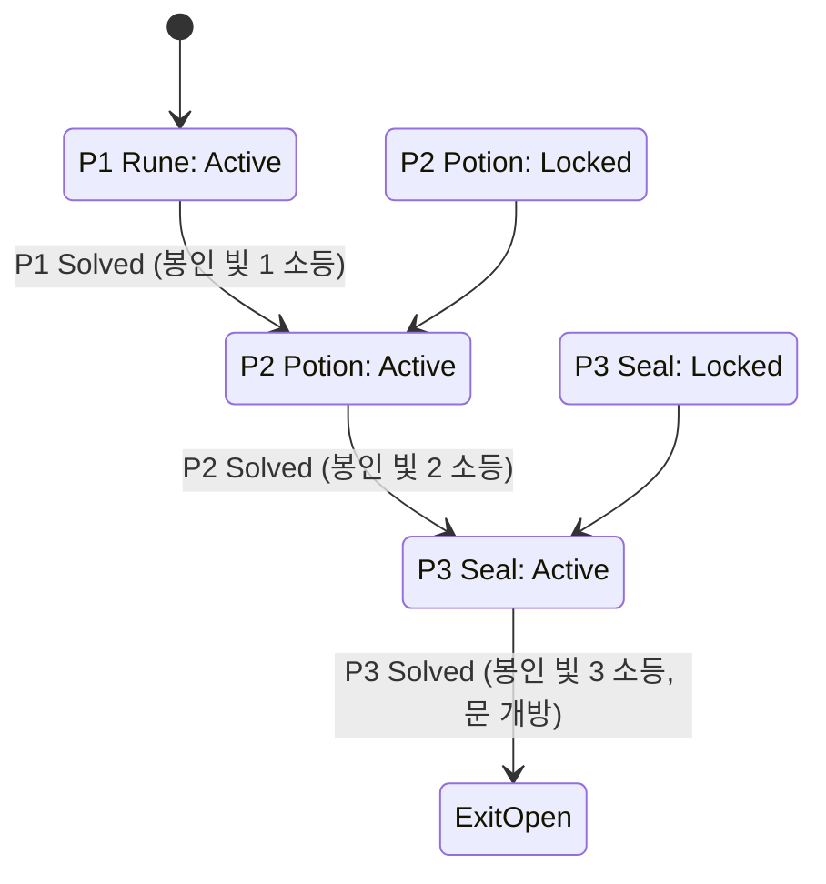

# MagicEscape — 게임 기획서 (Game Design Document)

> 정본 값(정답·아이템 ID·상태·문구)은 [`AGENTS.md`](../AGENTS.md) §5와 [`CodeDrafts/Core/GameText.cs`](../CodeDrafts/Core/GameText.cs)가 우선한다. 이 문서와 충돌하면 정본을 따르고 이 문서를 고친다.
> 작성일 2026-11-10 · 상태: 설계 완료 / Unity 구현 전(미검증)

## 1. 프로젝트 개요

| 항목 | 내용 |
|---|---|
| 이름 | MagicEscape — 마법학교 방탈출 |
| 장르 | 3D 1인칭 · 퍼즐 · 방탈출 · 판타지 |
| 플랫폼 | Windows PC (키보드 + 마우스) |
| 엔진 | Unity 6.3 LTS (6000.3.x), Universal 3D (URP) |
| 플레이 타임 | 10~15분 |
| 규모 | 메인 교실 1개, 핵심 퍼즐 3개, 시작/엔딩 연출 |
| 저장소 | https://github.com/NoNamad5196/MagicEscape |
| 과목 | 멀티미디어와 가상현실 (제출물: 실행 가능한 작품 + PPT 발표) |

## 2. 제작 배경 및 목적

- **과목 연계**: 3D 공간 구성, 조명·사운드·파티클 같은 멀티미디어 요소, 사용자 상호작용을 하나의 짧은 체험으로 묶는다.
- **직접 구현**: 프리셋 데모가 아니라 상호작용 시스템, 인벤토리, 퍼즐 3종의 상태 머신, 진행 관리, UI를 직접 설계·구현한다. 외부 에셋은 외형(모델·텍스처·효과·사운드)에만 쓴다.
- **VR 확장성**: 입력은 `PlayerInputReader` 한 곳, 상호작용은 `IInteractable` 인터페이스, 퍼즐 규칙은 엔진 독립 Core 클래스로 분리해 두어 이후 XR Interaction Toolkit으로 바꿀 때 입력 계층만 교체하면 된다.
- **확인 필요(교수님)**: ① VR 기능이 필수인지 ② 일반 PC 3D 작품도 '멀티미디어' 분야로 인정되는지. 확인 전까지 PC 3D로 진행하고 XR 전환은 하지 않는다.

## 3. 게임 장르 및 특징

- **한 방, 밀도 높은 탐색**: 12m×10m 교실 한 칸에 단서·재료·장치를 배치해 동선이 짧고 시연 시간이 예측 가능하다.
- **연결된 퍼즐 체인**: 퍼즐 1 보상(푸른 수정)과 퍼즐 2 보상(계시의 물약, 붉은 수정)이 퍼즐 3의 재료가 된다. 세 퍼즐이 '출구 봉인 빛 3개를 끄는' 하나의 목표로 이어진다.
- **명확한 피드백**: 정답은 청색/금색 발광과 차임, 오답은 빨간 점멸·검은 연기와 둔탁한 소리, 진행 상황은 출구 위 봉인 빛 개수로 항상 보인다.
- **실패 친화적**: 모든 퍼즐은 무제한 재시도, 일정 횟수 실패 시 힌트가 Tab 패널과 토스트로 제공된다. 게임오버 없음.

## 4. 세계관과 스토리

플레이어는 아르카나 마법학교 1학년 견습 마법사다. 방과 후 '원소 마법 실습' 보충 수업에 혼자 남아 연습하던 중, 실수로 교실 보안 주문 **'삼중 봉인'**을 발동시켜 버린다. 문 위의 봉인 빛 세 개가 붉게 타오르고 출구가 잠긴다. 담당 교수는 실습 교실 곳곳에 봉인을 푸는 단서를 남겨 두는 습관이 있다.

**오프닝 문구(타이틀 → 시작 시 토스트/화면 텍스트)**
> "펑—! 보충 수업 중 잘못 외운 주문이 교실의 삼중 봉인을 깨웠다. 문 위의 세 봉인 빛을 모두 꺼야 나갈 수 있다. 교수님은 늘 교실 어딘가에 단서를 남겨 두셨지…"

**엔딩 문구(클리어 화면, `GameText.Ending`)**
> "봉인을 모두 풀고 교실을 탈출했다. 오늘의 실습은 만점이다!"

## 5. 플레이어 목표

- 최종 목표: 출구 문 위 봉인 빛 3개(Seal1~3)를 모두 끄고 문 밖 ExitTrigger로 나간다.
- 중간 목표: P1 문양 해독 → P2 마법약 제조 → P3 최종 봉인 해제.
- 보조 목표(발표용 지표): 탈출 시간(클리어 화면 표시).

## 6. 핵심 게임 루프



## 7. 조작 및 상호작용

| 입력 | 동작 |
|---|---|
| W A S D | 이동 (걷기 3.2 m/s, 점프 없음) |
| 마우스 이동 | 시점 회전 (상하 ±80°) |
| E | 크로스헤어 아래 대상과 상호작용 / 읽기 패널 닫기 |
| 1~8, 마우스 휠 | 인벤토리 슬롯 선택(선택된 아이템을 가마솥·봉인 장치에 사용) |
| Tab | 목표·힌트 패널 열기/닫기 |
| ESC | 일시정지 / 읽기 패널 닫기 |

- 상호작용 판정: 화면 중앙에서 Raycast, 최대 2.5m. 대상이 있으면 크로스헤어 아래에 `[E] 대지 문양 누르기`처럼 동사구가 표시된다.

## 8. 레벨 및 공간 구성

교실 크기: 가로(X) 12m × 세로(Z) 10m × 높이 4.5m. 바닥 중앙이 원점 (0, 0), **+Z = 북쪽(출구)**, +X = 동쪽.

| 구역 | 오브젝트 | 위치 (x, z) / 높이 |
|---|---|---|
| 남쪽 | 플레이어 시작 지점(북쪽을 바라봄) | (0, -4.0) |
| 중앙 | 문양 제단 Altar(지름 1.6m, 높이 1.0m) | (0, 0.5) |
| 서쪽 벽 | 액자 4점 '씨앗의 일생' (왼→오: III, I, IV, II) | x=-5.9, z = -2.4 / -0.8 / 0.8 / 2.4, 높이 1.7 |
| 서쪽 벽 남단 | 칠판 | (-5.9, -4.0), 높이 1.5 |
| 동쪽 벽 | 책장 3개, 불도마뱀 비늘 유리병 | 책장 x=5.7, z=-1~3 / 병 (5.6, 1.5) 높이 1.4 |
| 북동 | 가마솥 Cauldron | (3.0, 2.5) |
| 북동 | 마법서 독서대 RecipeBook(+결계) | (4.2, 3.6) |
| 남동 창가 | 월광초 화분 | (5.0, -4.2) 창턱 높이 1.0 |
| 남서 | 교탁 + 열린 서랍(수정 가루) | (-3.5, -3.0) |
| 북서 구석 | 독버섯(함정) | (-5.4, 4.4) 바닥 |
| 북쪽 벽 | 출구 문 ExitDoor + 봉인 빛 3개 | 문 (0, 5.0), 빛은 문 위 높이 3.0 |
| 북쪽 | 봉인 장치 SealDevice (비문·소켓 2·봉인핵) | (0, 4.2) |
| 문 밖 | ExitTrigger | (0, 6.0) |

```text
                         북 (+Z)  ── 출구 문 ──
   ┌──────────────────────[ S1 S2 S3 ]──────────────────────┐
   │ 독버섯                [ 봉인 장치 ]              마법서 │
   │  (-5.4,4.4)        L ◇  ● 핵  ◇ R             (4.2,3.6)│
   │                                          가마솥        │
   │액자 II (2.4)                            (3.0,2.5)   책장│
 서│액자 IV (0.8)          ( 제단 )                  비늘병 │동
   │액자 I (-0.8)        6문양 (0,0.5)                   책장│
   │액자 III(-2.4)                                          │
   │        교탁·서랍                                       │
   │칠판   (-3.5,-3.0)                          월광초 화분 │
   │(-4.0)               ▲ 시작 (0,-4)            (5.0,-4.2)│
   └──────────────────────── 남 (-Z) ── 창문 ───────────────┘
```

**조명 구역**
- 전체: 어두운 청보라 Ambient(약 0.25 강도), 창으로 들어오는 푸른 달빛 Directional(약 0.3).
- 따뜻한 Point Light: 교탁 촛대, 책장 위 랜턴 2개, 가마솥 아래 불(주황).
- 퍼즐 강조: 제단 위 Spot(약한 백색), 봉인 장치 위 Spot, 봉인 빛 3개(빨강 Point Light).
- URP Volume: Bloom(Threshold 0.9, Intensity 1.2), Vignette 0.25, 약한 Color Adjustments(따뜻하게).

## 9. 퍼즐 1 — 마법 문양 해독 (요약)

- 목표: 제단의 문양 6개 중 4개를 **대지 → 물 → 불 → 빛** 순서로 누른다.
- 단서: 서쪽 벽 액자 4점(흙 속 씨앗=대지, 비=물, 햇볕의 열기=불, 빛 속에 핀 꽃=빛)과 각 아래 로마숫자 판. 액자는 III, I, IV, II 순으로 섞여 걸려 있다. 칠판: "생명은 정해진 순서로 깨어난다. 액자의 숫자를 따르라."
- 오답: 즉시 전체 소등 + 빨간 점멸, 처음부터 다시. 3회 실패부터 힌트.
- 완료: 문양 금색 발광 → 제단 뚜껑 열림 → 푸른 수정 등장, 봉인 빛 1 소등, 마법서 결계 해제(P2 시작).
- 상세: [PUZZLE_SPEC.md §1](PUZZLE_SPEC.md#1-퍼즐-1--마법-문양-해독)

## 10. 퍼즐 2 — 마법약 제조 (요약)

- 목표: 가마솥에 **월광초 꽃잎 → 불도마뱀 비늘 → 수정 가루** 순서로 넣어 '계시의 물약'을 만든다.
- 단서: 마법서(P1 해결 후 열람) "계시의 물약 — ① 달빛 아래 핀 꽃잎 ② 불꽃 속에서 벗겨낸 비늘 ③ 별처럼 빛나는 가루. 독버섯은 결코 넣지 말 것."
- 재료는 게임 시작부터 주울 수 있지만, 가마솥은 P1 해결 전까지 차갑다.
- 오답(순서 틀림·독버섯): 검은 연기, 이번 시도에 넣은 재료 전부 원위치 재생성, 2회 실패부터 힌트.
- 완료: 물약 금색 발광, 계시의 물약 + 붉은 수정 지급, 봉인 빛 2 소등(P3 시작).
- 상세: [PUZZLE_SPEC.md §2](PUZZLE_SPEC.md#2-퍼즐-2--마법약-제조)

## 11. 퍼즐 3 — 최종 봉인 해제 (요약)

- 목표: 출구 앞 봉인 장치에서 ① 비문에 계시의 물약 사용 → ② 왼쪽 소켓에 푸른 수정, 오른쪽 소켓에 붉은 수정 → ③ 중앙 봉인핵 활성화.
- 단서: 물약으로 드러나는 비문 "왼쪽엔 흐르는 것을, 오른쪽엔 타오르는 것을." + 왼쪽 물 문양, 오른쪽 불 문양(P1의 문양 지식 재사용).
- 오답: 틀린 소켓의 수정은 튕겨 나옴(소모 없음), 2회 실패부터 힌트.
- 완료: 봉인 빛 3 소등 → 1초 뒤 문이 2초에 걸쳐 열림 → 문 밖으로 나가면 클리어.
- 상세: [PUZZLE_SPEC.md §3](PUZZLE_SPEC.md#3-퍼즐-3--최종-봉인-해제)

## 12. 퍼즐 간 진행 조건





| 퍼즐 | 시작 상태 | Active 조건 | Solved 효과 |
|---|---|---|---|
| P1 Rune | Active | 게임 시작 | 봉인 빛 1 소등, 푸른 수정 등장, 마법서 결계 해제, P2 Active |
| P2 Potion | Locked | P1 Solved | 봉인 빛 2 소등, 물약·붉은 수정 지급, P3 Active |
| P3 Seal | Locked | P1·P2 Solved | 봉인 빛 3 소등, 출구 개방, ExitTrigger 활성 |

구현: `ProgressionModel`(Core)이 순서를 강제한다. 순서가 맞지 않는 해결 보고는 무시되고 경고 로그가 남는다.

## 13. 아이템 및 인벤토리

| itemId | 이름 | 위치/획득 | 사용처 | 소모 |
|---|---|---|---|---|
| `ing_moonpetal` | 월광초 꽃잎 | 남동 창가 화분 | 가마솥 ① | 투입 시 |
| `ing_salamander_scale` | 불도마뱀 비늘 | 동쪽 책장 유리병 | 가마솥 ② | 투입 시 |
| `ing_crystal_dust` | 수정 가루 | 교탁 서랍 | 가마솥 ③ | 투입 시 |
| `ing_toadstool` | 독버섯(함정) | 북서 바닥 구석 | 넣으면 실패 | 투입 시(곧 원위치 재생성) |
| `crystal_sapphire` | 푸른 수정 | P1 완료 후 제단 안 | 왼쪽 소켓 | 정답 소켓에 끼울 때 |
| `crystal_ruby` | 붉은 수정 | P2 완료 시 자동 지급 | 오른쪽 소켓 | 정답 소켓에 끼울 때 |
| `potion_revelation` | 계시의 물약 | P2 완료 시 자동 지급 | 봉인 비문 | 비문 해독 시 |

- 8칸 고정, 동시에 최대 7종이므로 실제로는 가득 차지 않는다. 가득 차면 "인벤토리가 가득 찼다." 토스트 후 아이템은 제자리에 남는다.
- 사용 규칙: 가마솥·비문·소켓은 **현재 선택된 슬롯**의 아이템을 쓴다. 선택 칸이 비었으면 "손에 든 아이템이 없다. 숫자키나 휠로 아이템을 선택하자."
- 재료가 아닌 아이템을 가마솥에 넣으려 하면 "이건 넣을 수 없다."(소모·실패 없음).

## 14. UI/UX

| 화면 | 구성 | 진입/종료 |
|---|---|---|
| 시작(Title) | 게임 제목, 한 줄 설명, [시작] [종료] | 실행 시 표시, 시작 버튼 → Playing |
| HUD | 중앙 크로스헤어, 그 아래 `[E] …` 프롬프트, 상단 중앙 토스트(3초), 하단 8칸 인벤토리 바 + 선택 아이템 이름 | Playing/Paused 동안 |
| 읽기 패널 | 단서 제목 + 본문(액자·칠판·마법서·비문) | 조사 시 열림, E/ESC로 닫힘, 열린 동안 이동·시점 잠금 |
| 목표/힌트(Tab) | 현재 목표 1줄 + 조건 충족 시 "힌트: …" | Tab 토글 |
| 일시정지 | [계속하기] [다시 시작] [종료], 시간 정지(timeScale 0) | ESC |
| 클리어 | "탈출 성공!", 탈출 시간 mm:ss, 엔딩 문구, [다시 시작] [종료] | 출구 통과 시 |

- 커서: 플레이 중 잠금·숨김, 그 외 화면에서는 표시.
- 폰트: 한글 지원 TMP 폰트 에셋 필수(Noto Sans KR 또는 Pretendard로 SDF 생성, [VISUAL_REFERENCES.md](VISUAL_REFERENCES.md) 참조).
- 프롬프트 문구 예: `[E] 대지 문양 누르기`, `[E] 월광초 꽃잎 줍기`, `[E] 불도마뱀 비늘 넣기`, `[E] 비문 조사하기`, `[E] 수정 끼우기`, `[E] 봉인핵 활성화`.

## 15. 사운드 및 비주얼 연출

**BGM**: 잔잔한 오르골/하프 계열 판타지 루프 1곡(플레이 시작 시 재생, 볼륨 0.4).

| 이벤트 (`SfxId`) | 소리 | 시각 효과 |
|---|---|---|
| Interact | 가벼운 클릭 | — |
| Pickup | 짧은 반짝임 | 아이템 사라짐 |
| RunePress | 돌 누름 + 맑은 톤 | 해당 문양 청색 발광 |
| RuneWrong | 둔탁한 실패음 | 전체 문양 빨간 점멸 0.6초 |
| RuneSolved | 상승 차임 | 문양 6개 모두 금색, 제단 파티클 |
| CauldronAccept | 보글보글 + 첨벙 | 물약 색 변화(청→주황→초록) |
| CauldronWrong | 펑 + 쉭 | 검은 연기 파티클, 물약 소등 |
| PotionSolved | 마법 차임 | 금색 발광 + 반짝이 파티클 |
| SocketPlace | 수정 '딸깍' | 소켓 청색 발광, 수정 표시 |
| SocketReject | 튕김 | 소켓 빨간 점멸 |
| SealReveal | 신비로운 웅- | 비문 글자 등장 + 보라 발광 |
| SealRelease | 큰 해제음 | 봉인핵 금색 + 파티클 |
| DoorOpen | 무거운 문 끼익 | 문 회전, 문틈 빛 파티클 |
| Clear | 팡파레 짧게 | 클리어 패널 |
| UiClick | UI 클릭 | — |

**출구 개방 시퀀스(봉인핵 E 시점 = 0초)**
- 0.0s 봉인핵 금색 발광, 해제 파티클, SealRelease, 토스트 "마지막 봉인이 풀렸다! 출구가 열린다."
- 0.5s P3 Solved 보고 → 봉인 빛 3 소등
- 1.5s DoorOpen 사운드, 문틈 파티클, 문 회전 시작(-100°)
- 3.5s 문 완전 개방, ExitTrigger 활성
- 이후 플레이어가 문 밖으로 이동 → Cleared

## 16. C# 시스템 아키텍처 (개요)

```text
[Core: 순수 C#, UnityEngine 미참조, dotnet 테스트 34건]
  ProgressionModel · RunePuzzleLogic · PotionPuzzleLogic · SealPuzzleLogic · InventoryModel · GameText · ItemIds
        ▲ 소유/호출
[Runtime: MonoBehaviour]
  입력: PlayerInputReader → PlayerController / PlayerInteraction → IInteractable
  진행: GameManager(=PuzzleManager 통합) · InventoryManager · DoorController · ExitTrigger
  퍼즐: RunePuzzle+RuneStone · PotionPuzzle · SealPuzzle+SealInscription/CrystalSocket/SealCore
  표현: UIManager · HotbarUI · AudioManager · GlowFeedback · InspectableObject · ItemPickup
```

규칙은 Core, 연출·입력·연결은 Runtime. 상세는 [TECH_DESIGN.md](TECH_DESIGN.md).

## 17. 개발 단계

| 단계 | 내용 | 담당 | 상태 |
|---|---|---|---|
| P0 | 기획, 퍼즐 설계, 저장소·문서 체계 | Instabox | 완료 |
| P1 | 시스템/상태 전이 설계 | Instabox | 완료 |
| P2 | C# Core + 테스트, Runtime 초안 | Instabox | 완료(Core 테스트 통과 / Runtime은 스텁 컴파일만) |
| P3 | 씬·프리팹·Inspector 명세 | Instabox | 완료(문서) |
| P4 | 인수인계, Notion 정리 | Instabox | 완료(문서) |
| W1 | Unity 프로젝트 생성, 스크립트 적용, 컴파일 | Windows | 대기 |
| W2 | 그레이박스 씬, 퍼즐 3종 연결, Play Mode 테스트 | Windows | 대기 |
| W3 | 에셋·조명·사운드·VFX, 빌드, 시연 리허설, PPT 캡처 | Windows | 대기 |

## 18. 테스트 시나리오 (요약)

- 자동(서버): Core 규칙 34건 xUnit — 정답/오답/힌트 임계/잠금/순서 강제/시간 정지/인벤토리 경계/전체 탈출 흐름.
- 수동(Windows Play Mode): 정상 클리어 1회, 퍼즐별 오답 경로, 순서 위반(P1 전 가마솥), 일시정지·재시작, 콘솔 오류 0건, 빌드 실행.
- 상세: [TEST_PLAN.md](TEST_PLAN.md)

## 19. 기대 효과

- **학습**: 3D 공간 설계, 1인칭 상호작용, 상태 머신 기반 게임 진행, URP 조명·포스트프로세싱·파티클·사운드 통합 경험.
- **설계 역량**: 엔진 독립 규칙 계층과 단위 테스트로 Unity 밖에서도 게임 로직을 검증하는 구조.
- **발표**: 퍼즐 상태도, 클래스 구조도, 테스트 결과, 실제 플레이 영상으로 '직접 구현한 시스템'을 명확히 보여 줄 수 있다.
- **확장**: 입력 계층 교체로 VR(XR Interaction Toolkit) 버전, 퍼즐 추가는 Core 클래스 + Interactable 조합으로 가능.

## 20. 참고 자료

- 비주얼·에셋·라이선스: [VISUAL_REFERENCES.md](VISUAL_REFERENCES.md)
- 퍼즐 상세: [PUZZLE_SPEC.md](PUZZLE_SPEC.md) · 시스템: [TECH_DESIGN.md](TECH_DESIGN.md) · 씬: [SCENE_SETUP.md](SCENE_SETUP.md) · 인수인계: [UNITY_HANDOFF.md](UNITY_HANDOFF.md)
- Unity 6.3 LTS 출시 공지(2025-12-04): https://discussions.unity.com/t/unity-6-3-lts-is-now-available/1697328 (조사일 2026-11-10)
- Input System 설치/Active Input Handling: https://docs.unity3d.com/Packages/com.unity.inputsystem@1.16/manual/Installation.html
- TextMeshPro의 uGUI 2.0 통합: https://discussions.unity.com/t/2023-2-latest-development-on-textmesh-pro/917387
