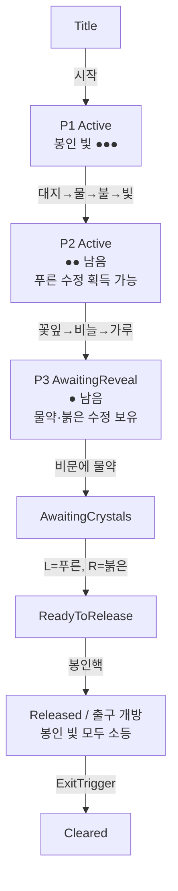

# MagicEscape — 퍼즐 3종 구현 명세

## S10e 표시 계층 정정 (Core 규칙 불변)
- P1 Earth→Water→Fire→Light: 칠판 I→II→III→IV 씨앗 스케치, 액자의 큰 유색 문양. ProgressCount만큼 대응 액자 점등, 오답 0개. 로마숫자/벽 순서 III,I,IV,II 유지.
- P2 moonpetal→salamander_scale→crystal_dust: 달/꽃잎→불/비늘→별가루 그림, 독버섯 X. 액체 청백→주황→금, 실패 시 탁한 보라검정/검은 연기. 소모/복원 로직 불변.
- P3 Left=sapphire, Right=ruby: 물약 사용 시 문장 패널 대신 물/불 각인 확대 점등과 소켓 물줄기/불씨 공개. 수정 자체의 물방울/불씨가 독립된 짝 단서.
- E는 그림 확대. 기존 실패 임계치 3/2/2에서만 자동 글 힌트, Tab은 현재 단서 문장 안전망. GameText의 정답·상수 변경 없음.

> 규칙 구현: `CodeDrafts/Core/RunePuzzleLogic.cs`, `PotionPuzzleLogic.cs`, `SealPuzzleLogic.cs`, `ProgressionModel.cs`
> 연출 구현: `CodeDrafts/Runtime/Puzzles/*.cs` · 모든 문구는 `GameText.cs` 상수와 동일
> 상태: 규칙은 dotnet 테스트 통과, Unity 연출은 미검증

공통 규칙
- 모든 상호작용은 E키, 화면 중앙 Raycast 2.5m.
- 가마솥·비문·소켓은 **선택 슬롯의 아이템**을 사용한다.
- 재시도는 무제한, 게임오버 없음. 실패 횟수는 퍼즐별로 누적되며 리셋되지 않는다.
- 힌트는 실패 임계치 도달 후 ① 오답 토스트 아래 "힌트: …" ② Tab 패널에 상시 표시.

---

## 1. 퍼즐 1 — 마법 문양 해독

**목적**: 교실 단서를 관찰해 순서를 추론하고 입력하는 관찰형 퍼즐. 첫 봉인을 풀고 마법서를 연다.

**선행 조건**: 없음(게임 시작 시 `PuzzleState.Active`).

**관련 GameObject**

| 이름 | 컴포넌트 | 역할 |
|---|---|---|
| `Altar` | `RunePuzzle` | 퍼즐 본체, 정답 판정, 완료 연출 |
| `Altar/AltarLid` | (Transform) | 완료 시 +Z 0.6m 슬라이드 |
| `Altar/RuneStone_Earth` … `_Shadow` (6개) | `RuneStone`, `GlowFeedback`, Collider | 입력 버튼 |
| `Altar/Reward_Sapphire` | `ItemPickup`(hiddenAtStart) | 보상 푸른 수정 |
| `WestWall/Painting_I..IV` | `InspectableObject` | 단서 액자 |
| `WestWall/Chalkboard` | `InspectableObject` | 단서 문구 |
| `ExitDoor/SealLight_1` | (GameObject + Light) | P1 해결 시 소등 |

**문양 배치**(제단 윗면 반지름 0.6m 원, 북쪽부터 시계방향 60° 간격): 빛, 그림자, 대지, 바람, 물, 불. 배치 순서가 정답 순서와 다르게 섞여 있다.

**단서(정확한 문구)**

| 오브젝트 | 제목 | 본문 |
|---|---|---|
| Painting_III (z=-2.4, 가장 왼쪽) | 씨앗의 일생 III | "뜨거운 햇볕이 새싹을 깨운다." (모서리에 불 문양) |
| Painting_I (z=-0.8) | 씨앗의 일생 I | "씨앗이 흙 속에서 잠든다." (대지 문양) |
| Painting_IV (z=0.8) | 씨앗의 일생 IV | "빛 속에서 마침내 꽃이 핀다." (빛 문양) |
| Painting_II (z=2.4, 가장 오른쪽) | 씨앗의 일생 II | "비가 내려 씨앗을 적신다." (물 문양) |
| Chalkboard | 칠판 | "생명은 정해진 순서로 깨어난다. 액자의 숫자를 따르라." |

**입력 방식**: 문양석에 조준 → `[E] 대지 문양 누르기` → E.

**정답**: `Earth → Water → Fire → Light` (I → II → III → IV).

**상태 전이** (`RunePuzzleLogic.Press` → `RuneInputResult`)

| 현재 상태 | 입력 | 조건 | 결과 / 다음 상태 | 피드백 | 소모 |
|---|---|---|---|---|---|
| Active, 진행 k(0~2) | 문양 X | X == 정답[k] | `Progress`, 진행 k+1 | X 청색 발광, RunePress | — |
| Active, 진행 3 | 빛 | 정답[3] | `Solved`, Solved | 4개 금색, 완료 시퀀스 | — |
| Active, 진행 k | 문양 X | X ≠ 정답[k] | `Wrong`, 진행 0, 실패+1 | 전체 소등 + 빨간 점멸, RuneWrong, 토스트 | — |
| Locked/Solved | 아무 문양 | — | `Ignored` | 프롬프트 자체가 숨겨짐(Solved) | — |

**오답 처리**: 진행을 0으로 초기화, 켜진 문양 전부 소등 후 0.6초 빨간 점멸. 토스트 "문양의 빛이 꺼졌다. 순서가 틀린 것 같다."

**재시도**: 즉시 첫 문양부터 다시 입력 가능.

**힌트**: 실패 3회 이상 → "벽에 걸린 액자의 숫자 순서를 따라가 보자."

**완료 연출**(마지막 정답 입력 = 0초)
- 0.0s 빛 문양 청색 발광
- 0.4s 문양석 6개 모두 금색, RuneSolved, 제단 파티클
- 0.4~1.9s 제단 뚜껑 슬라이드(1.5초)
- 1.9s 푸른 수정 등장, 토스트 "제단의 봉인이 풀렸다! 제단 안에서 푸른 수정이 떠오른다.", P1 Solved 보고 → 봉인 빛 1 소등, P2 Active, 마법서 결계 비활성화

**다음 퍼즐 연결**: 마법서(조합법) 열람 가능, 가마솥 활성화(거품 파티클 시작). 푸른 수정은 P3 왼쪽 소켓용.

**엣지 케이스**
- 해결 후 문양석: 프롬프트 없음, 상호작용 불가.
- 완료 연출 도중 다른 문양 입력: `Ignored`.
- 푸른 수정을 줍지 않고 진행: P2는 가능, P3 소켓 단계에서 필요.
- 인벤토리 가득(이론상 불가): "인벤토리가 가득 찼다." 후 수정은 제자리에 남음.

**수용 기준**
- [ ] 정답 4회 입력으로 해결되고 봉인 빛 1이 꺼진다.
- [ ] 중간 오답 시 모든 문양이 꺼지고 처음부터 다시 해야 한다.
- [ ] 3번째 실패부터 힌트가 토스트와 Tab 패널에 보인다.
- [ ] 해결 후 마법서 결계가 사라지고 내용을 읽을 수 있다.
- [ ] 푸른 수정을 주울 수 있다.

---

## 2. 퍼즐 2 — 마법약 제조

**목적**: 탐색·수집·순서 조합 퍼즐. 인벤토리 사용법을 익히고 P3 재료를 만든다.

**선행 조건**: P1 Solved(그 전에는 가마솥이 Locked). 재료 줍기는 시작부터 가능.

**관련 GameObject**

| 이름 | 컴포넌트 | 역할 |
|---|---|---|
| `Cauldron` | `PotionPuzzle`, Collider | 퍼즐 본체 + 투입 상호작용 |
| `Cauldron/Liquid` | `GlowFeedback` | 물약 색 |
| `Cauldron/VFX_Bubble`, `VFX_Smoke`, `VFX_Success` | ParticleSystem | 상태 연출 |
| `RecipeBook` | `InspectableObject`(requirePuzzleSolved=Rune) | 조합법 |
| `RecipeBook/Barrier` | (구체 + 반투명 머티리얼) | P1 전 결계 |
| `Ingredient_Moonpetal` / `_SalamanderScale` / `_CrystalDust` / `_Toadstool` | `ItemPickup` | 재료 4종 |

**단서(정확한 문구)**
- 마법서(P1 전): 토스트 "마법서가 빛의 결계에 싸여 있다. 제단의 봉인을 먼저 풀어야 할 것 같다."
- 마법서(P1 후) 읽기 패널: 제목 "계시의 물약", 본문 "계시의 물약 — ① 달빛 아래 핀 꽃잎 ② 불꽃 속에서 벗겨낸 비늘 ③ 별처럼 빛나는 가루. 독버섯은 결코 넣지 말 것."
- 재료 위치 자체가 단서: 꽃잎은 창가 달빛 아래, 비늘은 '불꽃' 라벨 병, 가루는 별 모양 장식 서랍.

**입력 방식**: 재료 줍기 → 1~8/휠로 선택 → 가마솥 조준 `[E] 월광초 꽃잎 넣기` → E.

**정답**: `ing_moonpetal → ing_salamander_scale → ing_crystal_dust`

**상태 전이** (`PotionPuzzleLogic.Add` → `PotionInputResult`)

| 현재 상태 | 입력(선택 아이템) | 조건 | 결과 / 다음 | 피드백 | 소모 |
|---|---|---|---|---|---|
| Locked | 아무것 | — | `NotActive` | "가마솥이 차갑다. 제단의 봉인이 먼저인 것 같다." | 아니오 |
| Active | 없음(빈 칸) | — | (런타임 처리) | "손에 든 아이템이 없다. …" | 아니오 |
| Active | 수정/물약 | 재료 아님 | `NotIngredient` | "이건 넣을 수 없다." | 아니오 |
| Active, 진행 k | 재료 X | X == 조합법[k], k<2 | `Accepted`, 진행 k+1 | 물약 색 변경, CauldronAccept, "…을(를) 넣었다. (k+1/3)" | 예 |
| Active, 진행 2 | 수정 가루 | 정답 | `Solved` | 완료 시퀀스 | 예 |
| Active, 진행 k | 재료 X | X ≠ 조합법[k] (독버섯 포함) | `Wrong`, 진행 0, 실패+1 | 검은 연기, CauldronWrong, 재료 원위치 | 예(곧 재생성) |
| Solved | — | — | 프롬프트 숨김 | — | — |

**오답 처리**: 이번 시도에 넣은 모든 재료(`LastFailedBatch`, 틀린 재료 포함)를 각자의 원래 위치에 재생성한다. 토스트 "가마솥에서 검은 연기가 피어올랐다! 재료들이 제자리로 돌아갔다." 물약 발광 소등.

**재시도**: 재료를 다시 주워 처음부터. 실패 횟수만 누적.

**힌트**: 실패 2회 이상 → "마법서의 순서를 다시 읽어 보자. 독버섯은 함정이다."

**완료 연출**(수정 가루 투입 = 0초)
- 0.0s 물약 초록 발광, 첨벙 소리
- 0.8s 금색 발광, 반짝이 파티클, PotionSolved
- 0.8s `potion_revelation`, `crystal_ruby` 인벤토리 지급, 토스트 "계시의 물약이 완성되었다! 가마솥 바닥에서 붉은 수정도 얻었다.", P2 Solved → 봉인 빛 2 소등, P3 Active

**다음 퍼즐 연결**: 물약 → 봉인 비문, 붉은 수정 → 오른쪽 소켓.

**엣지 케이스**
- P1 전에 재료를 모두 모아 둠: 정상. P1 후 바로 투입 가능.
- 독버섯을 첫 번째로 넣음: `Wrong`, 독버섯만 재생성.
- 정답 2개 후 독버섯: 3개 모두 재생성.
- 같은 재료를 두 번 넣으려 함: 인벤토리에 1개뿐이라 불가.
- 수정을 넣으려 함: `NotIngredient`, 소모 없음.

**수용 기준**
- [ ] P1 전 가마솥 상호작용 시 차갑다는 메시지만 나오고 아이템이 줄지 않는다.
- [ ] 정답 순서로 3개를 넣으면 물약·붉은 수정이 인벤토리에 들어온다.
- [ ] 오답 시 넣었던 재료가 원래 자리에 다시 나타나 재수집할 수 있다.
- [ ] 2번째 실패부터 힌트가 보인다.
- [ ] 봉인 빛 2가 꺼진다.

---

## 3. 퍼즐 3 — 최종 봉인 해제

**목적**: 앞선 두 퍼즐의 결과물과 문양 지식을 통합하는 마무리 퍼즐.

**선행 조건**: P1·P2 Solved → P3 Active, `SealStage.Dormant → AwaitingReveal`.

**관련 GameObject**

| 이름 | 컴포넌트 | 역할 |
|---|---|---|
| `SealDevice` | `SealPuzzle` | 퍼즐 본체 |
| `SealDevice/Inscription` | `SealInscription`, Collider | 비문판 |
| `SealDevice/Inscription/RevealedText` | TextMeshPro(3D) + 문양 Quad | 해독 후 표시 |
| `SealDevice/Socket_Left` | `CrystalSocket`(Left), `GlowFeedback`, Collider | 물 문양 소켓 |
| `SealDevice/Socket_Right` | `CrystalSocket`(Right), `GlowFeedback`, Collider | 불 문양 소켓 |
| `Socket_*/PlacedCrystal` | 수정 모델(시작 비활성) | 삽입 표시 |
| `SealDevice/SealCore` | `SealCore`, `GlowFeedback`, Collider | 최종 검증 |
| `ExitDoor` | `DoorController` | 봉인 빛·문 개방 |
| `ExitDoor/ExitTrigger` | `ExitTrigger`, BoxCollider(Trigger) | 탈출 판정 |

**단서(정확한 문구)**
- 해독 전 비문: 물약 아닌 아이템/빈손 → "비문이 흐릿해 읽을 수 없다."
- 해독 후 비문 읽기 패널: 제목 "봉인 비문", 본문 "왼쪽엔 흐르는 것을, 오른쪽엔 타오르는 것을." + 3D 텍스트 아래 왼쪽 물 문양, 오른쪽 불 문양.

**정답**: 비문에 `potion_revelation` → `Left = crystal_sapphire`, `Right = crystal_ruby` (순서 무관) → `SealCore`.

**상태 전이** (`SealPuzzleLogic` → `SealActionResult`)

| 단계(SealStage) | 대상 · 입력 | 조건 | 결과 / 다음 단계 | 피드백 | 소모 |
|---|---|---|---|---|---|
| Dormant | 비문/소켓/핵 | P3 Locked | `Dormant` | "아직 봉인이 두 개 남아 있다." | 아니오 |
| AwaitingReveal | 비문 · 물약 | — | `Revealed` → AwaitingCrystals | 비문 등장, 보라 발광, SealReveal, 읽기 패널 | 예(물약) |
| AwaitingReveal | 비문 · 다른 것/빈손 | — | `InvalidItem` | "비문이 흐릿해 읽을 수 없다." | 아니오 |
| AwaitingReveal | 소켓 | — | `NotAvailable` | "소켓이 무엇을 원하는지 아직 알 수 없다. 비문을 먼저 읽어야 한다." | 아니오 |
| AwaitingCrystals | 소켓 · 맞는 수정 | 빈 소켓 | `CrystalPlaced` | 수정 표시, 청색 발광, SocketPlace | 예(수정) |
| AwaitingCrystals | 소켓 · 다른 수정 | 빈 소켓 | `Rejected`, 실패+1 | 빨간 점멸, SocketReject, "수정이 튕겨 나왔다. 이 자리가 아닌 것 같다." | 아니오 |
| AwaitingCrystals | 소켓 · 수정 아닌 것 | — | `InvalidItem` | "이건 넣을 수 없다." | 아니오 |
| AwaitingCrystals | 소켓 · 빈손 | — | (런타임 처리) | "손에 든 아이템이 없다. …" | 아니오 |
| AwaitingCrystals | 채워진 소켓 | — | `AlreadyFilled` | 프롬프트 숨김(채워진 소켓) | 아니오 |
| AwaitingCrystals | 두 번째 정답 수정 | 양쪽 채움 | `CrystalPlaced` → ReadyToRelease | 봉인핵 보라 발광 | 예 |
| AwaitingReveal/Crystals | 봉인핵 | — | `NotAvailable` | "봉인핵이 아직 잠잠하다. 두 수정을 모두 끼워야 한다." | 아니오 |
| ReadyToRelease | 봉인핵 | — | `Released` → Released | 출구 개방 시퀀스 | 아니오 |
| 해독 이후 | 비문 | — | 읽기 패널 재표시 | — | 아니오 |

**오답 처리**: 틀린 소켓 → 수정이 인벤토리에 그대로 남음(소모 없음), 소켓 빨간 점멸.

**힌트**: 거부 2회 이상 → "물은 흐르고 불은 타오른다. 수정의 색을 보자."

**완료 연출**: [GAME_DESIGN.md §15 출구 개방 시퀀스](GAME_DESIGN.md#15-사운드-및-비주얼-연출) — 0s 해제, 0.5s 봉인 빛 3 소등, 1.5s 문 회전 시작, 3.5s ExitTrigger 활성.

**엔딩 트리거**: 열린 문 밖 ExitTrigger(BoxCollider Trigger, 2×2.5×1m)에 플레이어 진입 → `ProgressionModel.Escape()` → Cleared → 클리어 패널(탈출 시간 mm:ss + 엔딩 문구).

**재시작**: 일시정지/클리어 화면 [다시 시작] → 현재 씬 재로드(모든 상태 초기화). [종료] → 빌드에서는 앱 종료, 에디터에서는 Play Mode 종료.

**엣지 케이스**
- P3 Active 전에 봉인 장치를 만짐: `Dormant` 메시지. 단, P1만 풀었을 때도 "두 개 남아 있다"로 고정 문구 사용(봉인 빛 개수로 실제 남은 수 확인 가능).
- 물약 사용 전 수정을 소켓에: `NotAvailable`.
- 푸른 수정을 줍지 않음: 오른쪽만 채운 뒤 진행 불가 → 제단으로 돌아가 줍기.
- 문이 열리는 도중 출구로 달려감: ExitTrigger는 문 완전 개방 후 활성화되므로 그 전에는 통과 판정 없음.

**수용 기준**
- [ ] P1·P2 전에는 어떤 부품을 만져도 진행되지 않는다.
- [ ] 물약을 쓰면 비문과 두 문양이 나타나고 물약이 사라진다.
- [ ] 수정을 반대로 끼우면 거부되고 수정은 사라지지 않는다.
- [ ] 두 수정을 맞게 끼우고 봉인핵을 누르면 봉인 빛 3이 꺼지고 문이 열린다.
- [ ] 문 밖으로 나가면 클리어 화면과 탈출 시간이 표시된다.

---

## 4. 전체 상태 전이 요약

| 단계 | ProgressionModel (Rune/Potion/Seal) | SealStage | 켜진 봉인 빛 |
|---|---|---|---|
| 시작 | Active / Locked / Locked | Dormant | 3 |
| P1 해결 | Solved / Active / Locked | Dormant | 2 |
| P2 해결 | Solved / Solved / Active | AwaitingReveal | 1 |
| 비문 해독 | 〃 | AwaitingCrystals | 1 |
| 수정 2개 | 〃 | ReadyToRelease | 1 |
| 봉인 해제 | Solved / Solved / Solved | Released | 0 (문 개방) |

## 5. 정답 치트시트 (시연용)

1. 제단: **대지 → 물 → 불 → 빛**
2. 꽃잎(남동 창가), 비늘(동쪽 책장 병), 가루(교탁 서랍) 수집 → 가마솥에 **꽃잎 → 비늘 → 가루** (독버섯 금지)
3. 제단 안 **푸른 수정** 줍기(P1 직후)
4. 봉인 비문에 **계시의 물약** → 왼쪽 **푸른 수정**, 오른쪽 **붉은 수정** → 중앙 **봉인핵**
5. 열린 문 밖으로 이동

최단 시연 동선 약 3~4분, 일반 플레이 10~15분 목표.
