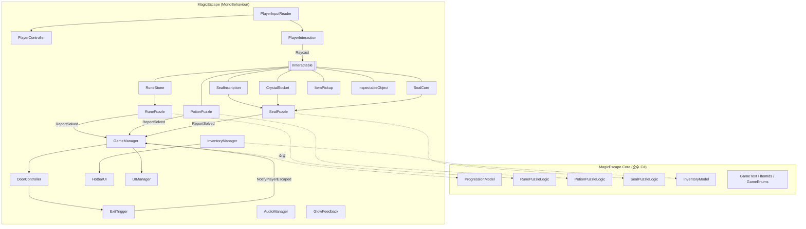
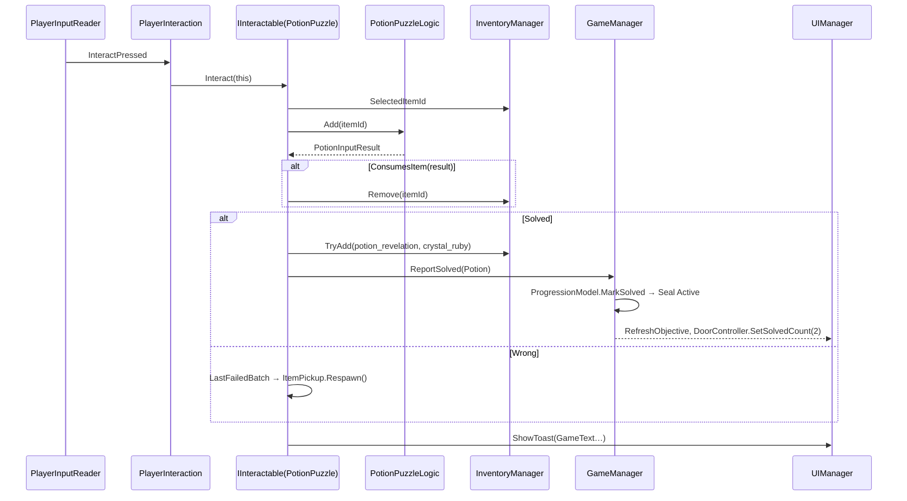

# MagicEscape — 시스템 및 C# 아키텍처

> 코드 위치: `CodeDrafts/Core`(순수 C#), `CodeDrafts/Runtime`(MonoBehaviour)
> 검증 상태: Core = dotnet xUnit 34/34 통과 · Runtime = Unity API 스텁으로 C# 9 컴파일(새/구 입력 백엔드 모두 오류·경고 0) · **실제 Unity 컴파일·Play Mode는 미검증**

## 1. 설계 원칙

1. **규칙과 표현 분리**: 정답 판정·상태 전이·인벤토리 규칙은 `MagicEscape.Core`(UnityEngine 미참조). MonoBehaviour는 입력을 받아 Core를 호출하고 결과 enum에 따라 연출만 한다.
2. **입력 단일 지점**: 키보드/마우스는 `PlayerInputReader`만 읽는다. VR 전환 시 이 계층과 `PlayerInteraction`의 Raycast 출처만 교체한다.
3. **공통 상호작용 계약**: E로 상호작용하는 모든 것은 `IInteractable`(GetPrompt/Interact).
4. **단일 진행 정본**: 퍼즐 잠금/해결·게임 흐름은 `ProgressionModel` 하나가 소유하고 이벤트로 알린다.
5. **최소 추상화**: 싱글톤 4개(GameManager, InventoryManager, UIManager, AudioManager)와 직렬화 참조만 사용. DI 프레임워크·이벤트 버스·ScriptableObject 이벤트 채널은 쓰지 않는다.
6. **Unity 호환 문법**: C# 9 이하, nullable 비활성, Core는 `noEngineReferences` asmdef.

## 2. 계층 구조



## 3. 파일 목록과 책임

### Core (`CodeDrafts/Core`, 9개 + asmdef)

| 파일 | 타입 | 책임 |
|---|---|---|
| `GameEnums.cs` | `GameFlowState`, `PuzzleId`, `PuzzleState`, `RuneId`, `SealStage`, `SocketSide` | 공용 상태 정의 |
| `ItemIds.cs` | `ItemIds` | itemId 문자열 정본 7개 |
| `GameText.cs` | `GameText` | 모든 토스트·힌트·단서·목표 문구 |
| `InventoryModel.cs` | `InventoryModel` | 8칸 보관, 선택 슬롯, 추가/제거/순환 선택, `Changed` |
| `RunePuzzleLogic.cs` | `RunePuzzleLogic`, `RuneInputResult` | P1 즉시 판정, 오답 리셋, 실패·힌트 |
| `PotionPuzzleLogic.cs` | `PotionPuzzleLogic`, `PotionInputResult` | P2 순서 판정, `LastFailedBatch`, 소모 규칙 |
| `SealPuzzleLogic.cs` | `SealPuzzleLogic`, `SealActionResult` | P3 단계 머신, 소켓 판정, 소모 규칙 |
| `ProgressionModel.cs` | `ProgressionModel` | 흐름 상태, 퍼즐 잠금 순서 강제, 경과 시간, 출구 |
| `MagicEscape.Core.asmdef` | — | `noEngineReferences: true`, autoReferenced |

### Runtime (`CodeDrafts/Runtime`, 22개)

| 폴더/파일 | 책임 | 주요 Inspector 필드 |
|---|---|---|
| `Input/PlayerInputReader` | 이동·시점·E·ESC·Tab·1~8·휠. `#if ENABLE_INPUT_SYSTEM` / `ENABLE_LEGACY_INPUT_MANAGER` | newInputMouseScale(0.1) |
| `Player/PlayerController` | CharacterController 이동, 마우스 시점, `ControlEnabled` | cameraPivot, walkSpeed 3.2, gravity -15, mouseSensitivity 2, pitch ±80 |
| `Player/PlayerInteraction` | Raycast 2.5m, 프롬프트, E 실행, 슬롯·Tab·ESC 라우팅, `Say()` | viewCamera, interactDistance, interactMask |
| `Interaction/IInteractable` | `GetPrompt(PlayerInteraction)`, `Interact(PlayerInteraction)` | — |
| `Interaction/InspectableObject` | 단서 읽기 패널, 퍼즐 해결 전 잠금 + 결계 표시 | promptVerb, title, body, requirePuzzleSolved, requiredPuzzle, lockedMessage, barrierVisual |
| `Interaction/ItemPickup` | 줍기, `Respawn()`, `Reveal()` | item, promptVerb, hiddenAtStart |
| `Items/ItemData` | ScriptableObject(itemId, displayName, description, icon) | — |
| `Managers/GameManager` | ProgressionModel 소유, 흐름별 커서/timeScale/조작/UI, 해결 보고, 목표·힌트 제공, 재시작/종료 | player, runePuzzle, potionPuzzle, sealPuzzle, exitDoor, skipTitle |
| `Managers/InventoryManager` | InventoryModel 래퍼, itemId→ItemData 조회 | capacity 8, itemCatalog[7] |
| `Puzzles/RunePuzzle` | P1 발광·완료 시퀀스·보상 | runeStones[6], altarLid, rewardCrystal, solvedVfx, 색상, hintThreshold 3 |
| `Puzzles/RuneStone` | 문양 버튼 | rune |
| `Puzzles/PotionPuzzle` | P2 투입·재생성·보상 지급 (가마솥 IInteractable) | ingredientPickups[4], liquidGlow, VFX 3종, stepColors, hintThreshold 2 |
| `Puzzles/SealPuzzle` | P3 진행·메시지·연출 | revealedInscription, inscriptionGlow, left/rightSocket, coreGlow, VFX, hintThreshold 2 |
| `Puzzles/SealInscription`, `SealCore`, `CrystalSocket` | P3 부품 상호작용 | puzzle / side, placedCrystalVisual, glow |
| `World/DoorController` | 봉인 빛 소등, 문 회전, ExitTrigger 활성 | hinge, openAngle -100, openSeconds 2, openDelay 1, sealLights[3], exitTrigger, openVfx |
| `World/ExitTrigger` | 플레이어 진입 → 탈출 | (Collider isTrigger) |
| `Effects/GlowFeedback` | URP Emission(MaterialPropertyBlock) + 선택 Light, `Flash` | targetRenderer, glowLight, intensity 3 |
| `UI/UIManager` | 패널 전환, 프롬프트, 토스트, 읽기, 목표/힌트, 클리어, 버튼 핸들러 | 패널 6개, TMP 텍스트 9개, toastSeconds 3 |
| `UI/HotbarUI` | 8칸 아이콘·선택 테두리·이름 | slotIcons[8], selectionFrames[8], selectedNameText |
| `Audio/AudioManager` | BGM, `SfxId` 15종 효과음, null 안전 static `Play` | bgmSource, sfxSource, bgmClip, clips[] |

> 지시서의 클래스 후보 대비: `PuzzleManager`는 `GameManager`에 통합(진행 정본이 하나이므로). `IInteractable`, `ItemData`, `DoorController`, `UIManager`, `AudioManager`, `InventoryManager`, `PlayerController`, `PlayerInteraction`, `RunePuzzle`, `PotionPuzzle`, `SealPuzzle`은 같은 이름으로 존재.

## 4. 실행 순서와 초기화

| 순서 | 클래스 | `[DefaultExecutionOrder]` | Awake/Start에서 하는 일 |
|---|---|---|---|
| 1 | PlayerInputReader | -100 | 매 프레임 입력을 가장 먼저 읽음 |
| 2 | InventoryManager | -60 | InventoryModel 생성, `Instance` |
| 3 | GameManager | -50 | ProgressionModel 생성·이벤트 구독, 참조 검증 로그 |
| 4 | UIManager | -40 | 읽기/목표/토스트 숨김 |
| 5 | 그 외(퍼즐 등) | 0 | Awake: Core 로직 생성·부품 Bind / Start: GameManager 이벤트 구독 및 현재 상태 동기화 |
| Start | GameManager | — | timeScale 1, 봉인 빛 3개 켬, 현재 흐름(Title)을 UI에 적용, `skipTitle`이면 바로 시작 |

- 퍼즐 컴포넌트는 Start에서 `Progression.GetState()`로 **현재 상태를 먼저 동기화**한 뒤 이벤트를 받는다(P1은 시작부터 Active이므로 이벤트 없이 활성화됨).
- 씬 재시작은 `SceneManager.LoadScene(buildIndex)`로 전체 초기화. static 상태는 각 싱글톤 `OnDestroy`에서 해제.

## 5. 상호작용 흐름 (시퀀스)



## 6. 상태 머신

### 6.1 게임 흐름 (`GameFlowState`)

| 현재 | 이벤트 | 다음 | 부수 효과 |
|---|---|---|---|
| Title | `StartGame()`(시작 버튼) | Playing | 커서 잠금, 조작 ON, BGM |
| Playing | ESC | Paused | timeScale 0, 커서 표시, 조작 OFF |
| Paused | ESC / 계속하기 | Playing | timeScale 1 |
| Playing | `Escape()` (출구 열림 + ExitTrigger) | Cleared | 클리어 패널, 시간 표시 |
| Paused/Cleared | 다시 시작 | (씬 재로드 → Title) | — |
| Playing + 읽기 패널 | — | Playing 유지 | 조작 OFF, 커서 표시(E/ESC로 닫음) |

경과 시간은 Playing일 때만 누적(`Tick`).

### 6.2 퍼즐 상태 (`PuzzleState`)
- P1: Active → Solved
- P2: Locked → Active(P1 Solved) → Solved
- P3: Locked → Active(P1·P2 Solved) → Solved → `ExitOpened` 이벤트
- 순서 위반 `MarkSolved`는 false 반환 + 경고 로그(테스트: `Potion_cannot_be_solved_before_rune`).

### 6.3 퍼즐별 결과 enum과 소모 규칙

| enum | 소모하는 결과 | 실패로 세는 결과 |
|---|---|---|
| `RuneInputResult` | (아이템 없음) | Wrong |
| `PotionInputResult` | Accepted, Wrong, Solved (`PotionPuzzleLogic.ConsumesItem`) | Wrong |
| `SealActionResult` | Revealed, CrystalPlaced (`SealPuzzleLogic.ConsumesItem`) | Rejected |

## 7. 이벤트 목록

| 발행자 | 이벤트 | 구독자 |
|---|---|---|
| ProgressionModel | `FlowStateChanged(GameFlowState)` | GameManager |
| ProgressionModel | `PuzzleStateChanged(PuzzleId, PuzzleState)` | GameManager(봉인 빛·목표), PotionPuzzle, SealPuzzle, InspectableObject(결계) |
| ProgressionModel | `ExitOpened` | GameManager → DoorController.Open |
| InventoryModel → InventoryManager | `Changed` | HotbarUI |
| UIManager | `ReadingChanged(bool)` | GameManager(조작 잠금) |
| SealPuzzleLogic | `StageChanged(SealStage)` | SealPuzzle(봉인핵 발광, 목표 갱신) |
| RunePuzzleLogic/PotionPuzzleLogic | `Progressed`, `Failed`, `Solved` | (확장용, 현재 결과 enum으로 처리) |

## 8. 오류 진단 로그 규칙

- 필수 참조 누락: `Debug.LogError("[클래스] 필드 미지정", this)` — Console 클릭 시 해당 오브젝트 하이라이트.
- 퍼즐 입력: `[RunePuzzle] Water → Progress (진행 2, 실패 0)` 형식으로 매 입력 기록.
- 진행: `[GameManager] Flow → Playing`, `[GameManager] Potion → Active`.
- 무시된 해결 보고: `LogWarning` (순서 버그 탐지).
- 토스트는 `[Toast] …`로 콘솔에도 남겨 UI 연결 전에도 흐름 확인 가능.

## 9. 테스트 전략

| 수준 | 대상 | 도구 | 상태 |
|---|---|---|---|
| 단위 | Core 5개 클래스 + 전체 탈출 시나리오 | `Tests/MagicEscape.Core.Tests` (xUnit, LangVersion 9, 경고=오류) | 34/34 통과 (2026-11-10) |
| 정적 | Runtime 22개 파일 이름·시그니처 정합성 | `Tests/RuntimeCompileCheck` (Unity API 스텁, New/Legacy 두 번 빌드) | 오류·경고 0 |
| 통합 | 씬 연결·물리·UI·사운드 | Unity Play Mode 수동 테스트 ([TEST_PLAN.md](TEST_PLAN.md)) | Windows 대기 |

> 스텁 컴파일은 실제 Unity API의 존재·동작을 보장하지 않는다(스텁은 Unity 6 공개 API 시그니처를 따라 작성했지만 사람이 작성한 것이다). Unity Editor 첫 컴파일이 최종 확인이다.

실행 방법(서버): 
```bash
~/.dotnet/dotnet test Tests/MagicEscape.Core.Tests
~/.dotnet/dotnet build Tests/RuntimeCompileCheck -p:InputBackend=New
~/.dotnet/dotnet build Tests/RuntimeCompileCheck -p:InputBackend=Legacy
```

## 10. VR 확장 지점

| 현재 | VR 전환 시 |
|---|---|
| `PlayerInputReader`(키보드/마우스) | XR 컨트롤러 입력 읽기(트리거=Interact, 스틱=Move) |
| `PlayerController`(CharacterController + 마우스 시점) | XR Origin + Continuous Move/Snap Turn Provider |
| `PlayerInteraction`(화면 중앙 Raycast) | 컨트롤러 Ray Interactor의 hit에서 `IInteractable` 조회 |
| 화면 공간 UI | World Space Canvas |
| Core 전체, 퍼즐 컴포넌트, IInteractable 구현체 | **변경 없음** |

## 11. 알려진 제한·결정 사항

- 인벤토리 슬롯은 '앞으로 당겨 채우기' 방식이라 아이템 제거 시 칸 위치가 바뀐다(7종뿐이라 허용).
- 아이템 드롭 기능 없음(퍼즐 진행에 불필요).
- 세이브/로드 없음(10~15분 단일 세션).
- 오디오는 2D 원샷 하나의 AudioSource. 3D 위치 사운드가 필요하면 각 오브젝트에 AudioSource 추가.
- `GlowFeedback`은 URP Lit의 `_EmissionColor`를 사용하므로 머티리얼의 Emission 체크가 필요하다.
